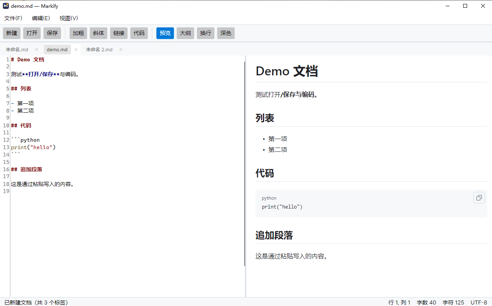

# Markify

一个用 [Avalonia 12](https://avaloniaui.net) 构建的轻量级 Markdown 编辑/预览客户端：左侧源码编辑，右侧原生控件实时预览，**不使用 WebView**。



## 特性

- **分栏实时预览** — 180ms 防抖，输入即所见；也可切换上下分栏或隐藏预览专注写作
- **双向滚动同步** — 滚动编辑器，预览跟随；滚动预览，编辑器跟随
- **大纲导航** — 左侧标题树，点击同时跳转源码行与预览锚点
- **Markdown 语法高亮** — AvaloniaEdit + TextMate（跟随明暗主题）
- **完整 GFM 渲染** — 表格、任务列表、围栏代码（带语言标签与复制按钮）、脚注、alert 块
- **文件处理** — 打开/保存/另存为，UTF-8(BOM)/UTF-16 编码保持，原子写入防中断损坏
- **未保存保护** — 新建、打开、关闭窗口三处均会确认
- **明暗主题** — 界面、编辑器、预览三者联动
- **拖放打开** / 命令行 `Markify doc.md`
- **状态栏** — 光标行列、字数（中文按字计）、字符数、编码

## 运行

需要 .NET SDK 10 或更高版本。

```powershell
cd src/Markify
dotnet run
```

打开指定文件：

```powershell
dotnet run -- ..\..\samples\demo.md
```

## 快捷键

| 快捷键 | 功能 |
| --- | --- |
| `Ctrl+N` / `Ctrl+O` / `Ctrl+S` / `Ctrl+Shift+S` | 新建 / 打开 / 保存 / 另存为 |
| `Ctrl+B` / `Ctrl+I` / `Ctrl+K` / `` Ctrl+` `` | 加粗 / 斜体 / 链接 / 行内代码 |
| `Ctrl+Shift+P` | 显示/隐藏预览 |

## 项目结构

```
src/Markify/
├─ App.axaml                     主题与样式引入（AvaloniaEdit / MarkView 必需）
├─ ViewModels/
│  └─ MainViewModel.cs           文档状态、防抖预览、大纲、命令
├─ Views/
│  ├─ MainWindow.axaml           布局：大纲 + 编辑器 + 预览 + 状态栏
│  ├─ MainWindow.axaml.cs        滚动同步、大纲导航、文件对话框、拖放
│  └─ HeadingLevelToMarginConverter.cs
├─ Services/
│  ├─ DocumentFileService.cs     编码探测、BOM 保持、原子写入
│  ├─ DocumentFormats.cs         支持的扩展名
│  ├─ IDocumentDialogService.cs  对话框抽象（VM 不依赖窗口）
│  └─ MarkdownOutline.cs         Markdig AST → 标题大纲 + GitHub 锚点
└─ docs/
   └─ avalonia-markdown-client.md   完整技术调研与选型报告
```

## 技术选型

| 层 | 选择 |
| --- | --- |
| UI | Avalonia 12.1.4 |
| 编辑 | AvaloniaEdit 12.0.0 + TextMate 高亮 |
| 渲染 | MarkView.Avalonia 12.4.0（Markdig → 原生 Avalonia 控件） |
| MVVM | CommunityToolkit.Mvvm 8.4.2 |

发布：支持 NativeAOT（已实测，`Markify.exe` 34.2MB）。

选型依据、与备选方案（Markdown.Avalonia、官方 Pro 控件、WebView）的对比、以及实现中遇到的 5 个关键坑，见 [docs/avalonia-markdown-client.md](docs/avalonia-markdown-client.md)。

## 已知限制

- 滚动同步当前为「按比例」，超长文档中源码行与预览内容会有轻微漂移（大纲导航可精确跳转）
- 暂不支持多标签页、导出 PDF/HTML、所见即所得模式

## NativeAOT

本项目**已通过 NativeAOT 实测验证**，并通过 CD 流程真正发布（[v0.1.0](https://github.com/iamartinlong/Markify/releases/tag/v0.1.0)）。

| 项目 | 实测 |
| --- | --- |
| `Markify.exe` | 34.21 MB |
| 运行文件合计（不含 pdb） | 52.72 MB / 5 个文件 |
| 发布包（zip） | 19.91 MB |
| AOT 自检 | 9/9 通过 |
| 裁剪 IL 警告 | 0 |
| 运行时内存 | 约 133 MB |

```powershell
dotnet publish src/Markify -c Release -r win-x64 -p:PublishAot=true -p:StripSymbols=true -o artifacts/aot
```

产物是 `Markify.exe` + 4 个原生库（Skia / HarfBuzz / onig / GLES），**不是严格单文件**。PDB 约 200MB，发布包已排除。

### 自检模式

编译通过不代表 AOT 能跑。应用内置 `--selftest`，在真实原生二进制里验证最易被裁剪破坏的 9 条路径（XAML 装载、AvaloniaEdit + TextMate、Markdig 解析、MarkView 控件树、主题模板 ScrollViewer、主题切换、CJK 字数、文件 IO）：

```powershell
artifacts/aot/Markify.exe --selftest --selftest-output artifacts/selftest-aot.txt
```

报告含 `isAot: yes/no`，用于确认跑的是 AOT 产物而非回落到 JIT。升级 Avalonia / MarkView 后建议重跑。

### 发布流程

| 工作流 | 触发 | 作用 |
| --- | --- | --- |
| `aot.yml` | push / PR | 每次提交验证 JIT 与 AOT 均可构建、自检通过 |
| `release.yml` | `v*` tag | 构建 → 自检 → 打包（排除 pdb）→ 校验包内二进制 → 生成 SHA-256 → 创建 GitHub Release |

发布新版本：

```powershell
git tag -a v0.2.0 -m "Markify v0.2.0"
git push origin v0.2.0
```

详见 [docs/avalonia-markdown-client.md §7.1](docs/avalonia-markdown-client.md)。

## 下载

从 [Releases](https://github.com/iamartinlong/Markify/releases) 下载 `Markify-<version>-win-x64.zip`，解压后直接运行 `Markify.exe`。

- 需要 Windows 10/11 x64
- **无需安装 .NET 运行时**（NativeAOT 自包含）
- 压缩包内含 `.sha256` 校验文件

## 许可

示例代码可自由使用。依赖库均为 MIT（Markdig 为 BSD-2-Clause）。
